```{=html}
<style>
.bb-ex summary { cursor: pointer; font-size: .9rem; opacity: .8; }
.bb-ex img { display: block; max-width: 100%; margin: .5rem 0 1rem; background: #fff; border-radius: 4px; padding: 6px; }
.bb-yt { width: 100%; aspect-ratio: 16 / 9; border: 0; border-radius: 6px; }
.bb-soloists { display: grid; grid-template-columns: repeat(auto-fit, minmax(170px, 1fr)); gap: .75rem; margin: 1rem 0; }
.bb-soloists div { border: 1px solid var(--bs-border-color, #ccc); border-radius: 6px; padding: .6rem .8rem; font-size: .9rem; }
.bb-soloists b { display: block; font-size: 1rem; }
</style>
```

Bach signed the dedication of six concertos to Christian Ludwig, Margrave of Brandenburg, on 24 March 1721, while he was music
director at the court of Cöthen. He had probably played for the Margrave two years earlier, on a trip to Berlin to collect a new
harpsichord, and been asked to "send some of his compositions". No. 2 is the loudest and most brilliant of the six: four soloists, one of
them a high trumpet, against strings and continuo.

Bar numbers like **8⁴** mean *bar 8, beat 4*: many sections start on an upbeat.

<iframe class="bb-yt" src="https://www.youtube-nocookie.com/embed/-HhkqBFTSoc?rel=0" title="Brandenburg Concerto No. 2, Freiburger Barockorchester, with scrolling score" loading="lazy" allowfullscreen></iframe>

*Freiburger Barockorchester on period instruments, with the score scrolling, so you can follow the bar numbers below.*

## The soloists

A **concerto grosso** sets a small group of soloists (the **concertino**) against the full string band (the **ripieno**), with the
**continuo** (harpsichord and a bass instrument) underneath everything. Here the concertino is unusual: four instruments that sound nothing
alike.

::: {.bb-soloists}
<div><b>Trumpet</b> A natural trumpet, with no valves, playing in its highest register. Bach writes "tromba"; some argue for a horn, but a high trumpet is the usual reading.</div>
<div><b>Recorder</b> Bach writes "fiauto": a treble recorder in F, not the transverse flute he asks for in No. 5. Modern performances sometimes use a flute.</div>
<div><b>Oboe</b> Close to the modern oboe, with fewer keys.</div>
<div><b>Violin</b> Gut strings and a lighter, shorter bow than a modern violin.</div>
:::

The continuo is **cembalo** (harpsichord) and **violone**, a large bowed bass that sounds an octave below the written note, usually
doubling the cello. Notice that the trumpet drops out completely in the slow movement.

## Ritornello form

The fast movements of a Baroque concerto are usually in **ritornello form**: the full band plays a theme (the **ritornello**, "little
return"), and it comes back, often shortened and in new keys, between **episodes** for the soloists.

**Tutti** ("all") and **solo** describe who is playing. **Ritornello** and **episode** describe *what material* is played. They usually
line up, but not always: in Bach a soloist can play ritornello material, and the full band can join a solo passage.

A ritornello often has three parts (Wilhelm Fischer's names, 1915):

1. **Initial statement** (*Vordersatz*): the opening idea that makes the theme recognisable.
2. **Spinning out** (*Fortspinnung*): a sequence that develops it.
3. **Ending** (*Epilog*): a short closing cadence figure.

Later ritornellos may use any one of the three parts. The keys usually follow a plan like this:

| Section | Key |
|---|---|
| Ritornello 1 | I |
| Solo 1 | I → V |
| Ritornello 2 | V |
| Solo 2 | V → a related key |
| Ritornello 3 | related key |
| Solo 3 | related key → I |
| Ritornello 4 | I |

::: {.bb-ex}
<details><summary>See it in Vivaldi: Violin Concerto Op. 3 No. 6, I, the first ritornello marked up</summary>


</details>
:::

Vivaldi's ritornellos are easy to hear. Bach's are much harder to find in this concerto, which is the point of the next section.

## I. [Allegro], F major

The boundaries between ritornello and solo are blurred: the soloists play the ritornello theme, and long stretches are counterpoint
between them. Some passages could be called either. Take the outline as one reasonable reading.

The ritornello has two ideas played at once: **Motive A** in the soloists and violins (flute, oboe, solo violin and violin I in unison,
violin II in thirds) and **Motive B**, running semiquavers in the lower strings. The trumpet can't play Motive A in this key, so it enters
in bar 2⁴ with an ascending figure of its own, which returns later.

| Bars | Section | Key | What happens |
|---|---|---|---|
| 1–8 | Ritornello (tutti) | F | Motive A over Motive B. |
| 8⁴–22 | Solo | | Each soloist plays a short solo; the ripieno answers with fragments of the ritornello. |
| 22⁴ | Ritornello (tutti) | C | |
| 28⁴ | Solo | | Trumpet: the flute's solo from 16⁴, a 4th higher. |
| 30⁴ | Ritornello (tutti) | d | |
| 32³ | Solo | | Imitation between soloists. |
| 36 | Ritornello | d | |
| 39⁴–47⁴ | Solo | | |
| 48 | Ritornello | | A short homophonic passage on the spinning-out (bar 3). |
| 50 | Ritornello | | |
| 58 | Ritornello | | |
| 59⁴ | Solo | | |
| 67⁴ | Ritornello (tutti) | c | |
| 72 | Solo | | |
| 75 | Ritornello | | |
| 76³ | Solo | | Trumpet and oboe imitate each other, like 32³. |
| 80 | Ritornello | g | Like the ritornello at 36. |
| 83⁴ | Solo | | |
| 94 | Ritornello | | |
| 95³ | Solo | | Flute and violin in imitative dialogue, like 32³. |
| 99 | Ritornello | | |
| 102⁴ | Ritornello | F | Most instruments start the initial statement in the home key; the trumpet differs, probably because of what it can play. |
| 107 | Solo | | |
| 115 | Ritornello | F | The spinning-out and a reworked ending close the movement. |

::: {.bb-ex}
<details><summary>Annotated excerpts, bars 1–47</summary>
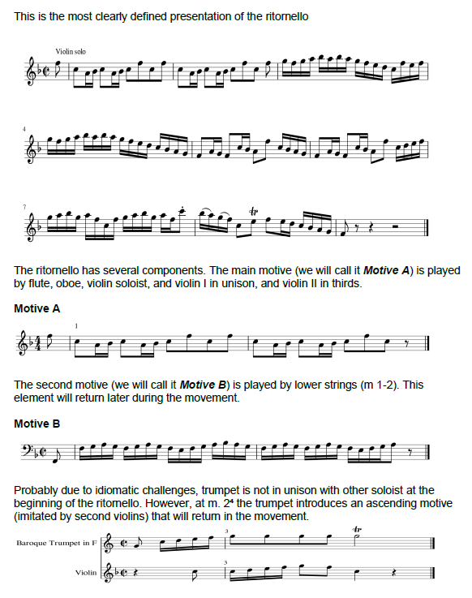
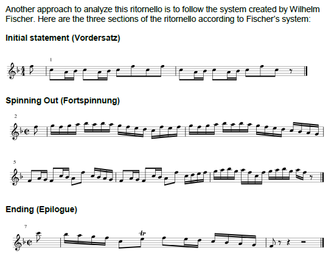
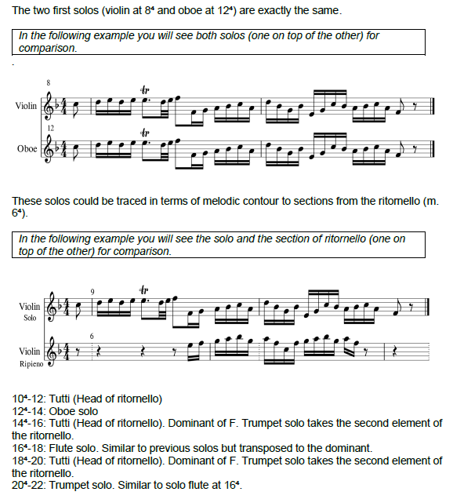
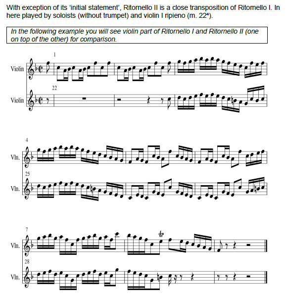
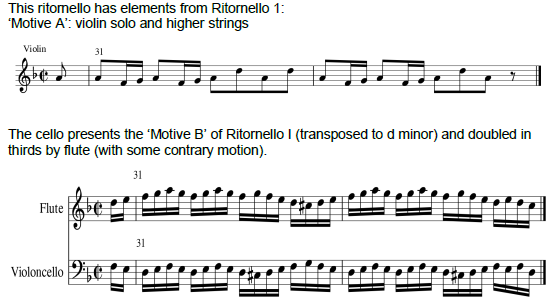
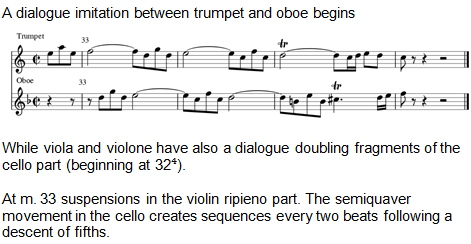
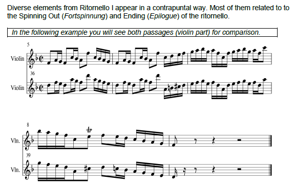
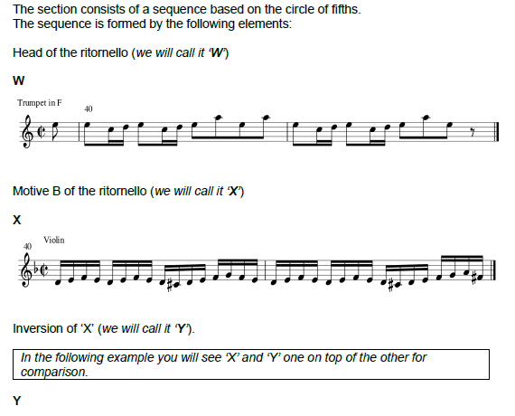
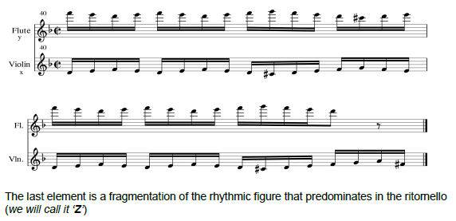
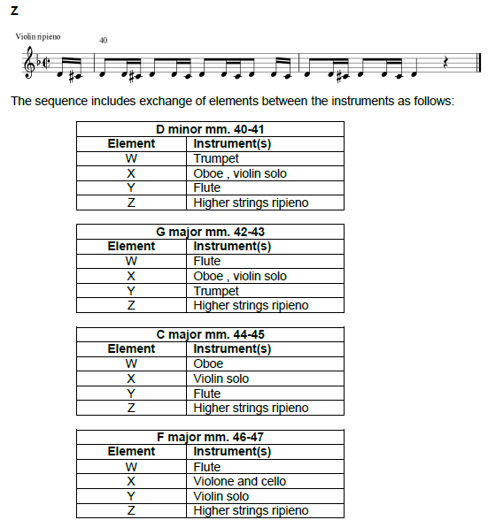
</details>
<details><summary>Annotated excerpts, bars 50–94</summary>
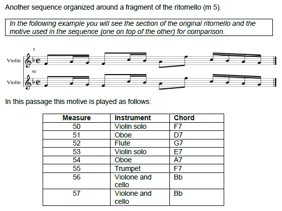
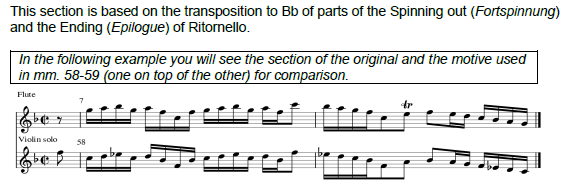
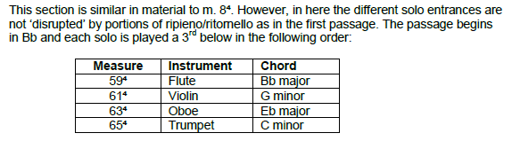
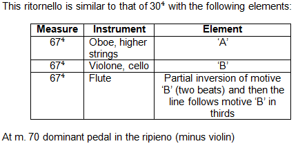
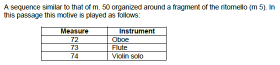
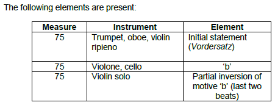
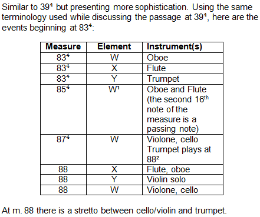
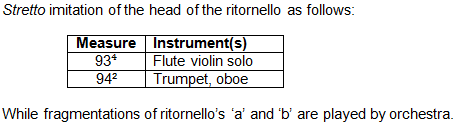
</details>
<details><summary>Annotated excerpts, bars 95–118</summary>
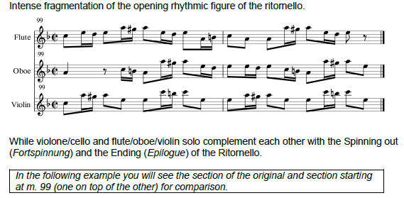
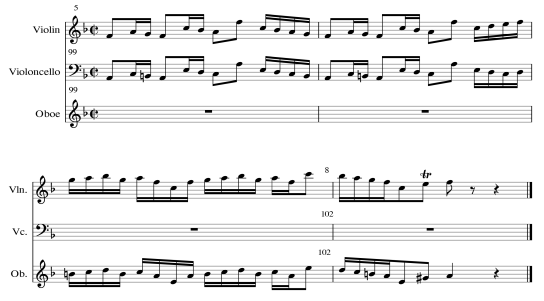
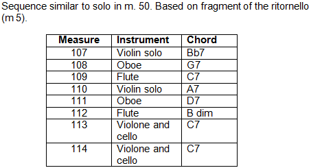
</details>
:::

**Listen for:** how often you can hear Motive A, and who is playing it. Is the passage you're hearing tutti, solo, or both?

## II. Andante, D minor

Chamber music inside a concerto: flute (recorder), oboe and violin over continuo, no trumpet and no ripieno. The whole movement grows from
the violin's opening motive, passed between the three soloists in imitation. Each section ends with a **cadence** you can hear clearly,
because the continuo's steady quavers stop. The cadences mark the keys: a, C, B♭, g, and home to d.

| Bars | Section | Key reached | What happens |
|---|---|---|---|
| 1³ | I | d | Violin: the opening motive, over a walking continuo bass. |
| 3³ | | | Oboe enters with the motive; the violin plays a countermelody. |
| 5³ | | | Flute enters an octave higher; the oboe takes the countermelody. |
| 7³ | | | Flute varies the motive; the B♮ points to A minor. |
| 11³ | | | Violin and oboe in thirds. |
| 14 | | **a** | Continuo stops: perfect cadence (V–I) in A minor. |
| 15³ | II | | Oboe varies the motive, flute countermelody. |
| 17³ | | | Violin with the motive, flute and oboe countermelodies. |
| 19³ | | | Flute, like 7³. |
| 22 | | **C** | Cadence in C major. |
| 23³ | III | | Violin varies the motive (G minor). |
| 25³ | | | Flute, with the same variation (D minor). |
| 27³ | | | Oboe, original motive. |
| 29³ | | | Violin, a new variation. |
| 31³ | | | Flute enters. |
| 32 | | **B♭** | Cadence in B♭ major. |
| 33 | IV | | Countermelodies in flute and oboe; a circle-of-fifths sequence starts in the bass (5 bars). |
| 37³ | | | Flute enters (E♭ major). |
| 39³ | | | Flute and oboe in parallel 6ths with the original motive. |
| 41³ | | | Flute, a new variation. |
| 42 | | **g** | Cadence in G minor. |
| 43³ | V | | Oboe, variation of the motive. |
| 57³ | | | Small variation in the violin. |
| 59³ | | | …in the oboe. |
| 61³ | | | …in the flute. |
| 63 | | **d** | A **hemiola** (three bars of 3/4 felt as two of 3/2) leads to the final cadence: no dominant chord, and a **Picardy third** (F♯ in the violin) turns the last chord major. |

::: {.bb-ex}
<details><summary>Annotated tables with excerpts, sections I–V</summary>
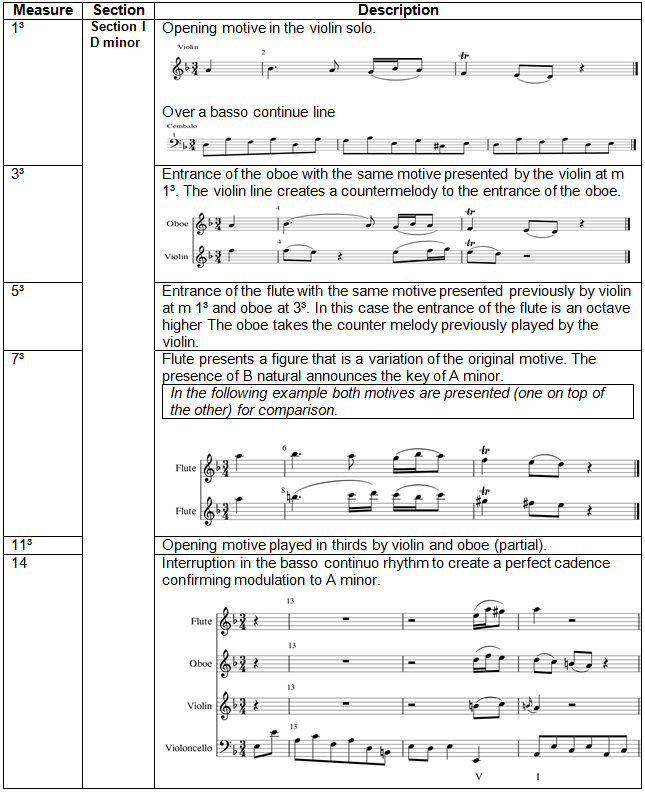
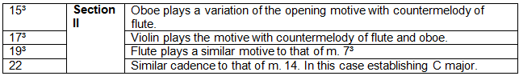
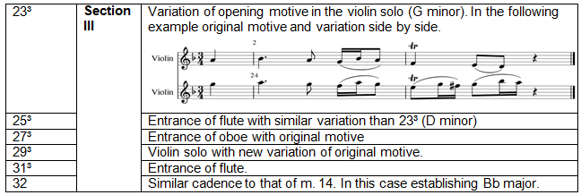
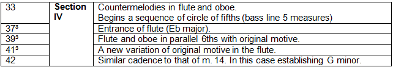
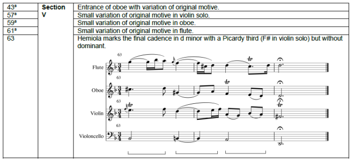
</details>
:::

**Listen for:** the five moments the bass stops. Can you hear whether each cadence is major or minor?

## III. Allegro assai, F major

Is it a **fugue** or a **ritornello** movement? It opens like a fugue: the trumpet plays a subject alone over continuo, and the other
soloists answer it in turn. But it also behaves like a concerto, with the ripieno joining for passages that work like ritornellos. The pack this
guide comes from calls it a hybrid. The table gives both readings.

| Bars | As a fugue | As a ritornello movement | What happens |
|---|---|---|---|
| 1 | Exposition | Solo | Subject in the trumpet, in F, over continuo. |
| 7 | | | Answer in the oboe, on C. It is a **real answer**: an exact transposition of the subject. Trumpet and oboe then develop its figures. |
| 21 | | | Subject in the violin, an octave below the trumpet. |
| 27 | | | Answer in the flute. |
| 33, 41 | | | Further entries. |
| 47 | Episode | | |
| 53 | | Ritornello | The ripieno joins. |
| 57–72 | Re-exposition | | Subject entries return. |
| 79 | Episode | | |
| 87, 97 | Episode | | |
| 113, 119 | Episode | | |
| 126, 136 | | Solo | |

::: {.bb-ex}
<details><summary>Annotated excerpts, bars 1–72</summary>
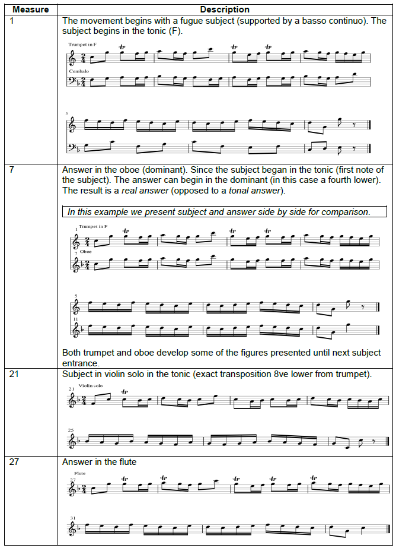
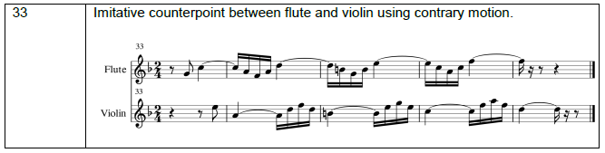
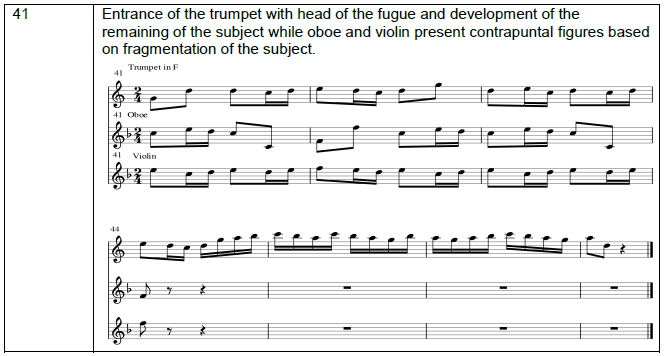
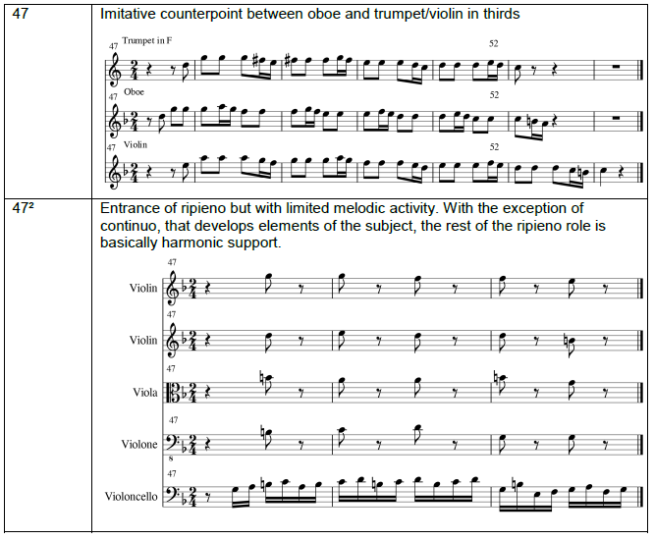
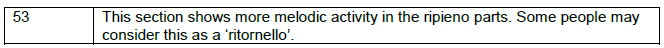
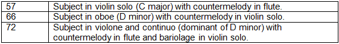
</details>
<details><summary>Annotated excerpts, bars 79–139</summary>
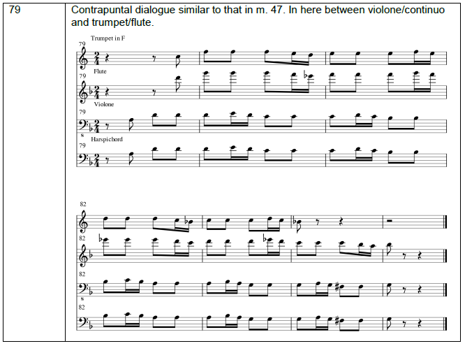
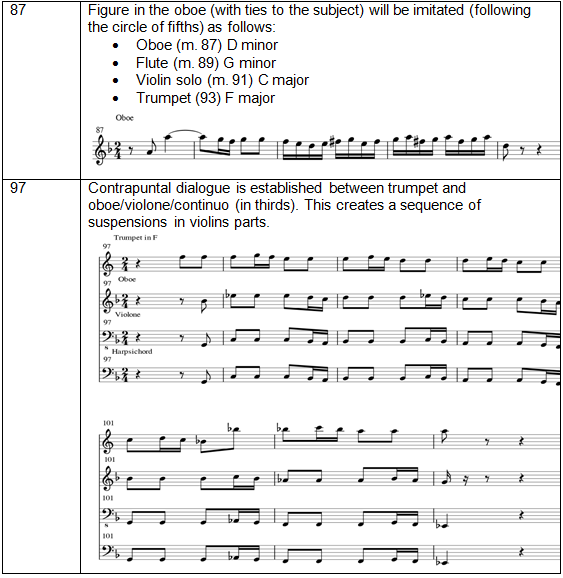
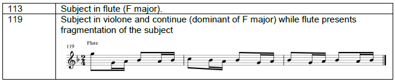
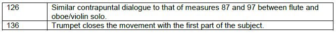
</details>
:::

**Listen for:** each time the subject enters, name the instrument. Which reading, fugue or ritornello, do you find more convincing, and why?

## Things to discuss

1. Compare the opening of movement I with a Vivaldi concerto. Why is Bach's ritornello harder to hear?
2. Why does the trumpet drop out of the slow movement? (Think about what a natural trumpet can play in D minor.)
3. Write a timeline of movement III marking each subject entry with its instrument and time in the recording.

<!-- works-cited: written by scripts/works-cited.py -->
::: {.works-cited}
Boyd, Malcolm. *Bach: The Brandenburg Concertos*. Cambridge UP, 1993. Fischer's Vordersatz / Fortspinnung / Epilog model (p. 48, as cited by the pack).

Carrell, Norman. *Bach's Brandenburg Concertos*. George Allen & Unwin, 1963. The "fiauto" in No. 2 as a treble recorder in F (p. 67, as cited by the pack).

Melamed, Daniel R., editor. *Bach Studies 2*. Cambridge UP, 1995. Ritornello structure (p. 168, as cited by the pack).
:::
<!-- /works-cited -->
