```{=html}
<style>
.bb-ex summary { cursor: pointer; font-size: .9rem; opacity: .8; }
.bb-ex img { display: block; max-width: 100%; margin: .5rem 0 1rem; background: #fff; border-radius: 4px; padding: 6px; }
.bb-yt { width: 100%; aspect-ratio: 16 / 9; border: 0; border-radius: 6px; }
</style>
```

Zoltán Kodály (1882–1967) spent seven childhood years in Galánta, a small market town between Vienna and Budapest (now in Slovakia),
where his father was stationmaster. There he first heard a Roma (Gypsy) band, "the first 'orchestral' sonority that came to the ears of
the child", as he later wrote. He returned there in 1905 on his first trip collecting folk songs. *Dances of Galánta* was written for the
80th anniversary of the Budapest Philharmonic Society and first played on 23 October 1933, conducted by Ernő Dohnányi.

<iframe class="bb-yt" src="https://www.youtube-nocookie.com/embed/daepERU8rnE?rel=0" title="Dances of Galánta with scrolling score" loading="lazy" allowfullscreen></iframe>

*With the score scrolling. Bar numbers on this page follow the corrected count: see [the note on bar numbers](#bar-numbers).*

## Verbunkos: slow, then fast

The piece is written in the style of **verbunkos**, a Hungarian dance first danced at army recruiting events in the 18th century to
make life in the cavalry look glamorous. It has two halves:

- **Lassú** (slow): rubato, dotted rhythms, an improvised feel. The senior officers danced first, slowly and with dignity.
- **Friss** (fresh, fast): virtuoso and getting ever faster, as the youngest soldiers joined in with leaps and spur-clicking.

Verbunkos was not "Gypsy music", but it was mostly Roma professional bands who played it, and their style (rubato, ornament, fiery
violin playing) shaped how 19th-century composers wrote in the *style hongrois*: think of Liszt's Hungarian Rhapsodies or Brahms's
Hungarian Dances. The **csárdás**, which grew out of verbunkos, has the same slow–fast plan.

Two accompaniment patterns to listen for:

- **Düvő**: a note repeated in pairs, the second slightly longer, as a string player bows down-up (bar 285, lower strings).
- **Esztam**: an off-beat "oom-pah", the low instrument on the beat and a higher one off it (bars 94, 119, 147, 250).

::: {.bb-ex}
<details><summary>Esztam in the score</summary>
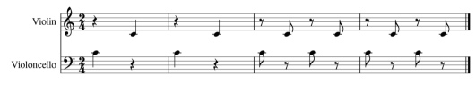
</details>
:::

The **clarinet cadenzas** (bars 34 and 45, and again at the end) may imitate the **tárogató**, a Hungarian single-reed folk instrument.

## Where the tunes come from

Kodály didn't use folk songs he had collected. The main themes come from books of Hungarian dances printed in Vienna around 1800, one of
them "after several Gypsies from Galánta", which he chose to keep that tradition alive. The guide labels the ten tunes he used **A** to
**J**. He rarely quotes a whole tune at once: he splits them into parts, introduces the first part, and brings in the rest later.

::: {.bb-ex}
<details><summary>The ten Viennese tunes, A–J</summary>
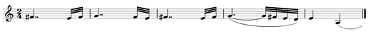
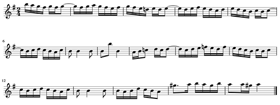
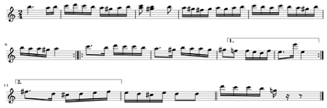
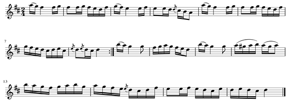
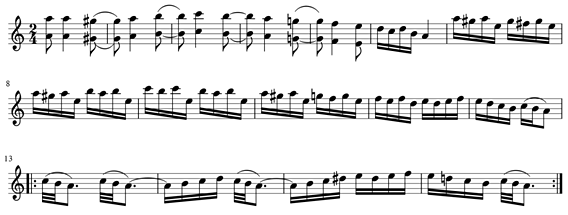
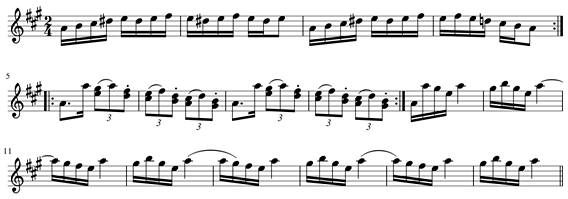
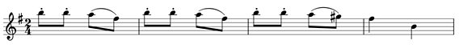
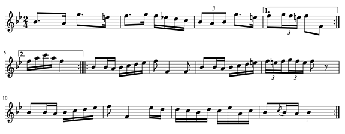
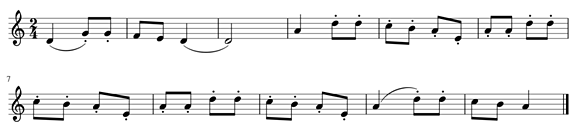
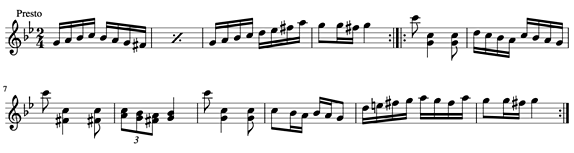
</details>
:::

## The form

The form is famously hard to pin down. The published score calls it a slow rondo (bars 1–412) followed by a fast movement. Others call it
a rondo with a very long finale. The guide this page comes from questions the score's version: the music is already fast at bar 238
(♩ = 140), and most of the fast tunes are new Viennese tunes, not variants of the slow ones. Its reading is a **verbunkos–rondo hybrid**:
a slow rondo whose refrain is Theme B, then a fast chain of new dances.

| Section | Part | From bar | Tunes |
|---|---|---|---|
| Introduction | | 1 | A |
| **Lassú** | Rondo A | 50 | B |
| | Rondo B | 94 | C |
| | Rondo A | 153 | B |
| | Rondo C | 175 | D |
| | Rondo A | 231 | B |
| **Friss** | Section 1 | 238 | E, F, G |
| | Section 2 | 336 | H |
| | Section 3 | 407 | I, J (first part) |
| | Section 4 | 445 | J (second part) |
| | Section 5 | 492 | E, F, J |
| **Coda** | | 567 | B, then J |

## Section by section

In the excerpts, the **top staff** is the old Viennese tune (transposed to match) and the **bottom staff** is Kodály's version. Red notes
are where they differ.

### Introduction (bars 1–49)

| Bar | What happens |
|---|---|
| 1 | Cellos: Theme A, note for note, with the double-dotted verbunkos rhythm. |
| 6 | Upper strings and flute answer in imitation, rubato. A fermata (bars 9–10) closes the pair. |
| 10 | Bar 1 again, horn, a 4th higher. |
| 15 | Bar 6 again, piccolo instead of flute. |
| 19 | *Poco più mosso*: pieces of both ideas pass quickly between oboe/flute (19), bassoon/viola (23), violins (27). |
| 34 | Clarinet: a quasi-cadenza on arpeggios from bar 6. |
| 37 | *Poco stringendo*: rising and falling arpeggios. |
| 45 | Clarinet cadenza ends the introduction. |

::: {.bb-ex}
<details><summary>Excerpts: bars 1, 6, 19</summary>
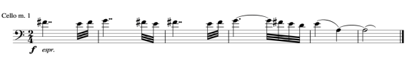
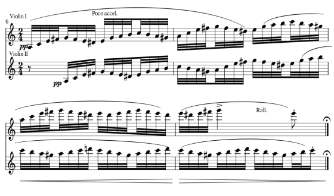
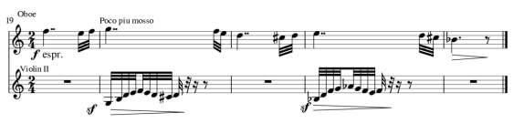
</details>
:::

### Lassú: the slow rondo (bars 50–237)

| Bar | Part | What happens |
|---|---|---|
| 50 | Rondo A | New tempo and metre. Clarinet: **Theme B**, with changes of rhythm and pitch. |
| 66 | | Theme B again (flute, clarinets, upper strings), a 4th higher. |
| 82 | | The second half of Theme B, like bar 74. |
| 94 | Rondo B | New tempo, metre and key. Pizzicato off-beats (esztam) set up… |
| 97 | | …**Theme C** in flute, joined by piccolo (104), then clarinets and upper strings (110). |
| 124 | | Theme C again, passed around the woodwind (124, 130), then clarinets and strings (136), flute/piccolo/oboe (140). The instruments in parallel give it a non-Western colour. |
| 153 | Rondo A | Theme B returns at its climax: *ff appassionato*, woodwind and upper strings. |
| 175 | Rondo C | **Theme D**, first part, very close to the original. |
| 183 | | Repeated an octave higher in the flute. |
| 191 | | Oboe: the second part of Theme D. |
| 199 | | Repeated in the piccolo. |
| 207 | | Pieces of Theme D interrupt each other in different instruments, tempos and keys (207, 211, 215, 219). |
| 223 | | A short rising motive (from bar 222) builds an 8-bar codetta with *stringendo*. |
| 231 | Rondo A | Theme B's first part at a climax, back in *Andante maestoso*, the tempo that always comes with Theme B. |

::: {.bb-ex}
<details><summary>Excerpts: Theme B at bars 50, 153, 231</summary>
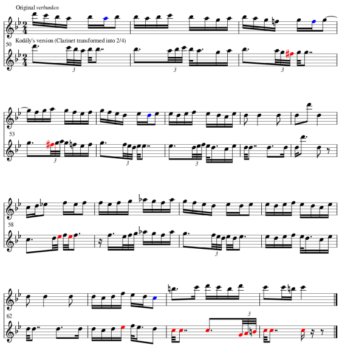
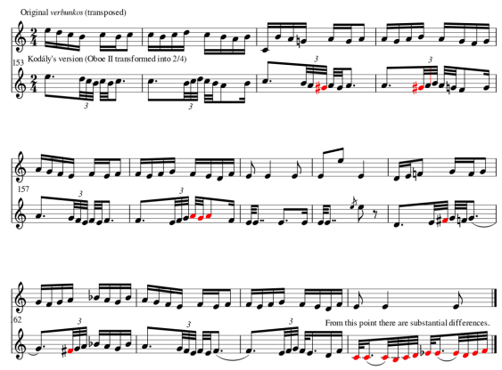
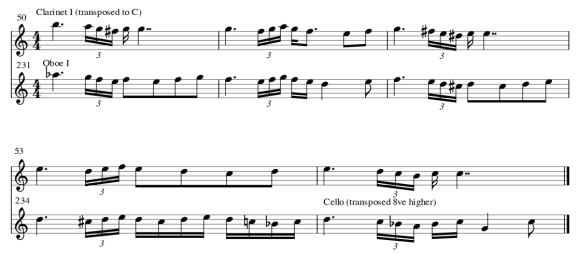
</details>
<details><summary>Excerpts: Theme C (bar 94) and Theme D (bars 175, 191, 223)</summary>
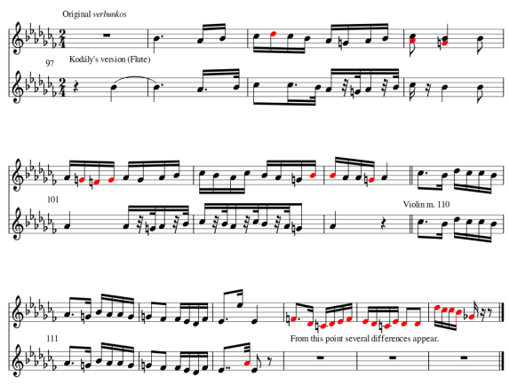
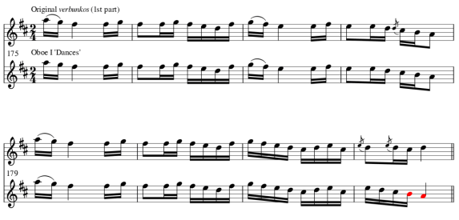
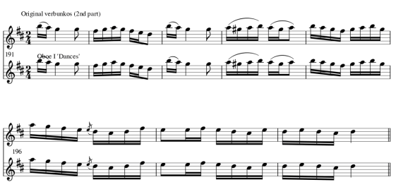
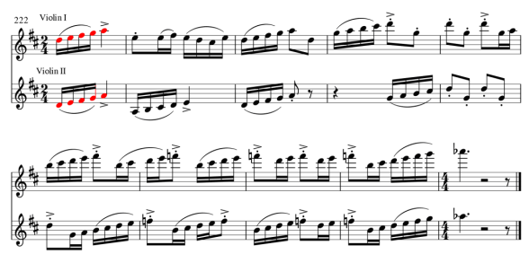
</details>
:::

### Friss: the fast dances (bars 238–566)

| Bar | Section | What happens |
|---|---|---|
| 238 | 1 | Violins: **Theme E**. |
| 254 | | Theme E in violin I, violin II a 6th below; at 260 flutes and clarinets start it, imitated by horn. |
| 270 | | Flute and oboes: **Theme F**, first part; varied at 274 in violin I. |
| 278 | | Theme E's first part; from 284 its third part, repeated an octave higher each time to build a crescendo. |
| 305 | | Piccolo and violins: **Theme G**, while oboe and clarinet play pieces of F. |
| 313 | | Theme F in stretto (violins 313, clarinets and bassoons 317, flutes and oboes 319), with Theme E on top. |
| 324 | | A 12-bar close: *p subito* and crescendo, syncopation, rising line, esztam, and *ritmo di 3 battute* (three bars felt as one). |
| 336 | 2 | *Poco meno mosso*. Trombones in canon (339); clarinet: **Theme H**, first part (348); flute (352). |
| 356 | | Theme H in bassoon and cello, with arpeggios growing out of its last bar. |
| 364 | | Violin I: the second part of Theme H, an octave higher at 372. |
| 379 | | Theme H's last bar repeated by many instruments as a codetta, fading to *poco sostenuto* (387). |
| 393 | | *A tempo* bridge: Theme H's first motive imitated around the orchestra. |
| 407 | 3 | Horn: **Theme I**, first part; repeated at 409 and 417. |
| 423 | | *Allegro vivace*: Theme I's second part in canon, viola and violin II. |
| 427 | | Flute and violin I: **Theme J**, first part, on top of it; then imitated (clarinets 431, violins 435–436). |
| 445 | 4 | Violin I: Theme J's second part; imitations follow (477, 491). |
| 492 | 5 | Most of the orchestra: Theme E varied, alternating with Theme F (492 E, 508 F, 512 E, 516 F, 520 E). |
| 508 | | Like bar 324 (*p subito*, syncopation, *ritmo di 3 battute*), now with scales in the high instruments. |
| 545 | | Violins: Theme J's second part, with woodwind motives around it. |

::: {.bb-ex}
<details><summary>Excerpts: Themes E, F, G (bars 238–305)</summary>
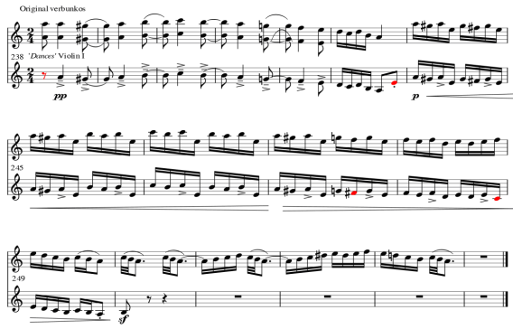
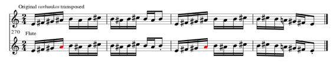
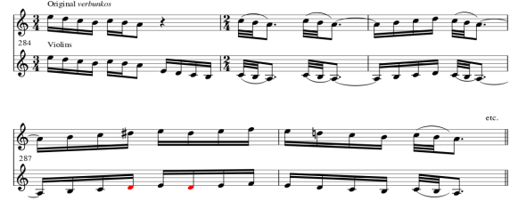
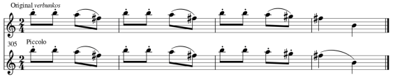
</details>
<details><summary>Excerpts: Themes H, I, J (bars 336–445)</summary>
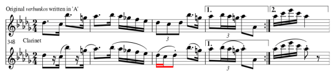
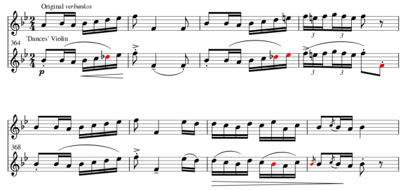
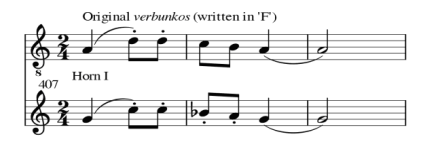
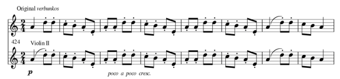
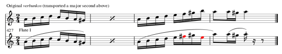
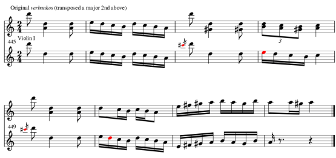
</details>
:::

### Coda (bars 567–end)

| Bar | What happens |
|---|---|
| 567 | A general pause, then *Andante maestoso*, Theme B's tempo; pieces of Theme B in flute, oboe and clarinet (569). |
| 573 | The clarinet's last statement turns into a cadenza like bar 45. |
| 581 | The ending, mostly on Theme J. |

## Things to discuss

1. Listen to the opening and to bar 238. Which features of lassú and friss can you hear in each?
2. Choose one of the excerpts above. What did Kodály change in the old tune, and why might he have changed it?
3. Is the piece a rondo? Argue for or against the form table above.
4. Compare the clarinet cadenzas with a recording of a tárogató. What is Kodály imitating?

## Bar numbers {#bar-numbers}

The Universal Edition score (UE 34121) misnumbers some bars: there are six bars between its printed 90 and 95, and between 130 and 135.
To get the bar numbers used on this page, add **1** to printed numbers from 95 to 134, and **2** from 135 on (printed 140 is bar 142).

<!-- works-cited: written by scripts/works-cited.py -->
::: {.works-cited}
Bellman, Jonathan. "Verbunkos." *Grove Music Online*, Oxford UP. Accessed 24 Aug. 2015 (as cited by the pack). Verbunkos: recruiting dance, lassú and friss.

Eősze, László. *Zoltán Kodály: His Life and Work*. Crescendo, 1962. The 1905 collecting trip (pp. 47–48).

Kodály, Zoltán. *Tänze aus Galanta für Orchester*. Universal Edition, 1934. Kodály's preface (pp. XI, XIII): the Galánta band, the Vienna dance books, the published description of the form.

Ong, Corinne K. *A Historical Overview and Analysis of the Use of Hungarian Folk Music in Kodály's Háry János Suite, Dances of Marosszék, and Dances of Galánta*. MM thesis, U of Kansas, 2011. The form as an enigmatic rondo (p. 81).

Schneider, David E. *Bartók, Hungary, and the Renewal of Tradition*. U of California P, 2006. Düvő and esztam (pp. 21–24).

Sárosi, Bálint. "Instrumental Folk Music in Kodály's Works." (as cited by the pack). The 1803 Vienna publication and Kodály's use of ten of its tunes; Roma professional musicians.

Young, Percy M. *Zoltán Kodály: A Hungarian Musician*. Greenwood, 1964. Galánta (p. 24).
:::
<!-- /works-cited -->
